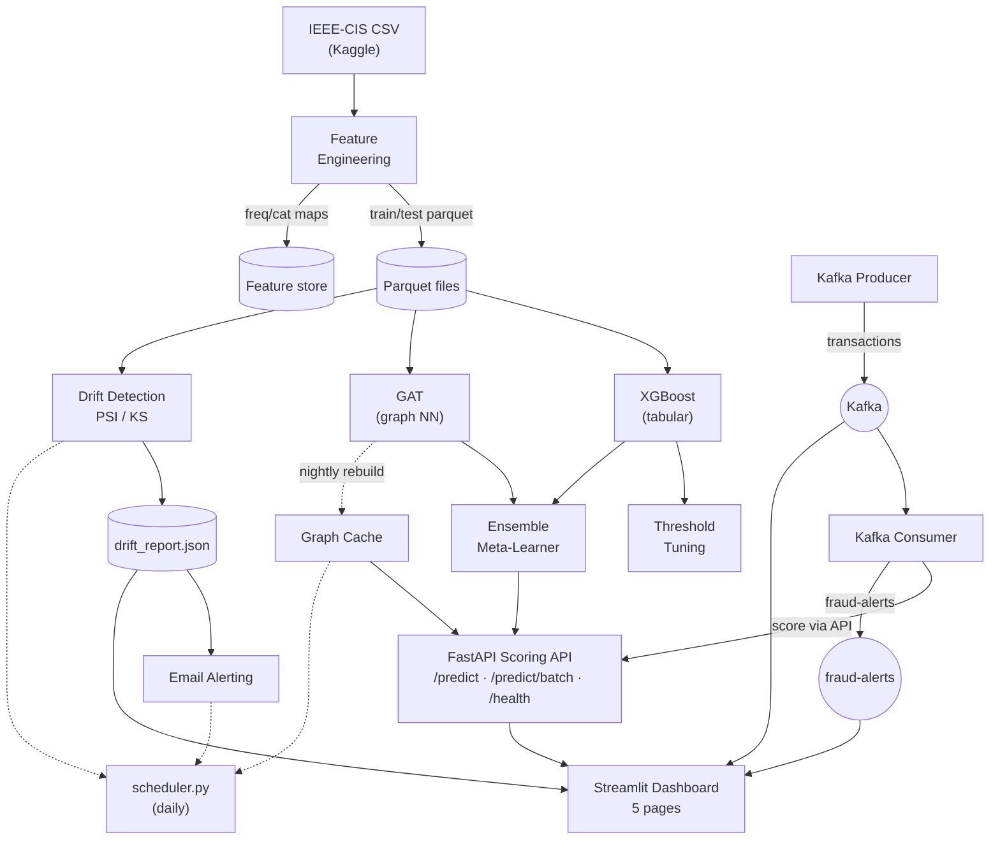

# Real-Time Financial Fraud Detection Platform

End-to-end fraud detection system for the IEEE-CIS Fraud Detection dataset:
feature engineering → XGBoost + Graph Attention Network ensemble → real-time
scoring API → Kafka streaming pipeline → monitoring dashboard.


## Results

| Model                   | ROC-AUC   | PR-AUC    | Notes                                                |
| ----------------------- | --------- | --------- | ---------------------------------------------------- |
| XGBoost (tuned)         | **0.951** | **0.736** | 62 engineered features, Optuna-tuned, threshold 0.72 |
| GAT (graph NN)          | 0.79\*    | —         | 590k nodes / 12.7M edges, 2-hop sampling             |
| Ensemble (meta-learner) | —         | —         | Logistic Regression stacking both models             |

\*GNN figures reflect 1-hop checkpoint; 2-hop retrain pending.

At the operating threshold the production model reaches **98.1% accuracy,
76.8% precision, 63.6% recall** on the validation holdout.

## Architecture



## Project Structure

```
├── api/                    FastAPI scoring service + graph-cache builder
│   ├── main.py             /predict, /predict/batch, /health endpoints
│   ├── inference.py        Shared preprocessing (API, consumer, ensemble)
│   └── build_graph_cache.py  Nightly GNN serving-cache builder
├── data/
│   ├── eda.py              Exploratory analysis, 8 plots + summary
│   ├── capture_demo.py     Playwright demo-frame recorder (optional)
│   └── processed/          Train/test parquets (generated)
├── dashboard/app.py        Streamlit dashboard, 5 pages
├── features/
│   ├── feature_engineering.py   62 features: velocity, freq, target encodings
│   └── feature_store_data/      Serialized lookup maps (feature store)
├── models/
│   ├── train_xgboost.py    Tuned XGBoost + MLflow logging
│   ├── tune_xgboost_optuna.py  Hyperparameter search
│   ├── train_gnn.py        GAT on full graph, mini-batch subgraph sampling
│   ├── tune_threshold.py   Precision/recall trade-off analysis
│   └── ensemble.py         XGBoost + GNN meta-learner
├── monitoring/
│   ├── drift_detection.py  PSI + KS drift tests, drift_report.json
│   └── alerting.py         Email alerts on drift
├── streaming/
│   ├── kafka_producer.py   Streams test transactions (schema-validated)
│   └── kafka_consumer.py   Scores via API, publishes to fraud-alerts
├── tests/                  Integration tests for the scoring API
├── scheduler.py            Daily pipeline: graph cache → drift → alerts
├── docker-compose.yml      API + dashboard + Kafka + Redis stack
└── main.py                 Single entrypoint for every component
```

## Quick Start

**Prerequisites:** Python 3.10, Docker (for Kafka/Redis), the IEEE-CIS
dataset in `data/raw/` ([kaggle.com/c/ieee-fraud-detection](https://www.kaggle.com/c/ieee-fraud-detection)).

```bash
# 1. Environment
py -3.10 -m pip install -r requirements.txt
cp .env.example .env   # if starting fresh

# 2. Run the full pipeline in order
python main.py features      # feature engineering
python main.py train         # XGBoost + GNN training
python main.py api           # scoring API on :8000
python main.py dashboard     # dashboard on :8501

# 3. Streaming (needs Kafka: docker run -p 9092:9092 apache/kafka:3.7.0)
python main.py producer
python main.py consumer

# 4. Monitoring
python main.py monitor
python scheduler.py --once   # one-shot daily pipeline
```

### Docker (everything at once)

```bash
docker compose up --build
# API        → http://localhost:8000/docs
# Dashboard  → http://localhost:8501
```

## Key Design Decisions

- **StandardScaler on node features** — fixed the GNN's exploding loss (9–22 → 0.62)
- **Chain-linking edge builder** — O(n·k) vectorised alternative to pairwise
  grouping, connecting transactions sharing `card1` / `addr1` / `P_emaildomain`
- **Manual subgraph batching** — PyG's fast samplers need torch-sparse (C++
  build); sampling is done with numpy CSR lookups instead, no extra deps
- **Identity-only drift exclusion** — M1–M9 PSI alerts traced to identity-table
  coverage skew (41% → 19% over time), not real drift; still reported, excluded
  from alerting
- **Threshold at 0.72** — chosen from the F1/precision/recall trade-off curves,
  prioritising precision for an alerting use case

## Testing

```bash
pytest tests/ -v          # scoring API integration tests (API must be running)
```

CI (GitHub Actions) runs compile checks plus schema/drift-report smoke tests
on every push.

## Data Source

[IEEE-CIS Fraud Detection](https://www.kaggle.com/c/ieee-fraud-detection) —
590k transactions with identity + transaction tables. Data files are
gitignored; place them under `data/raw/`.
